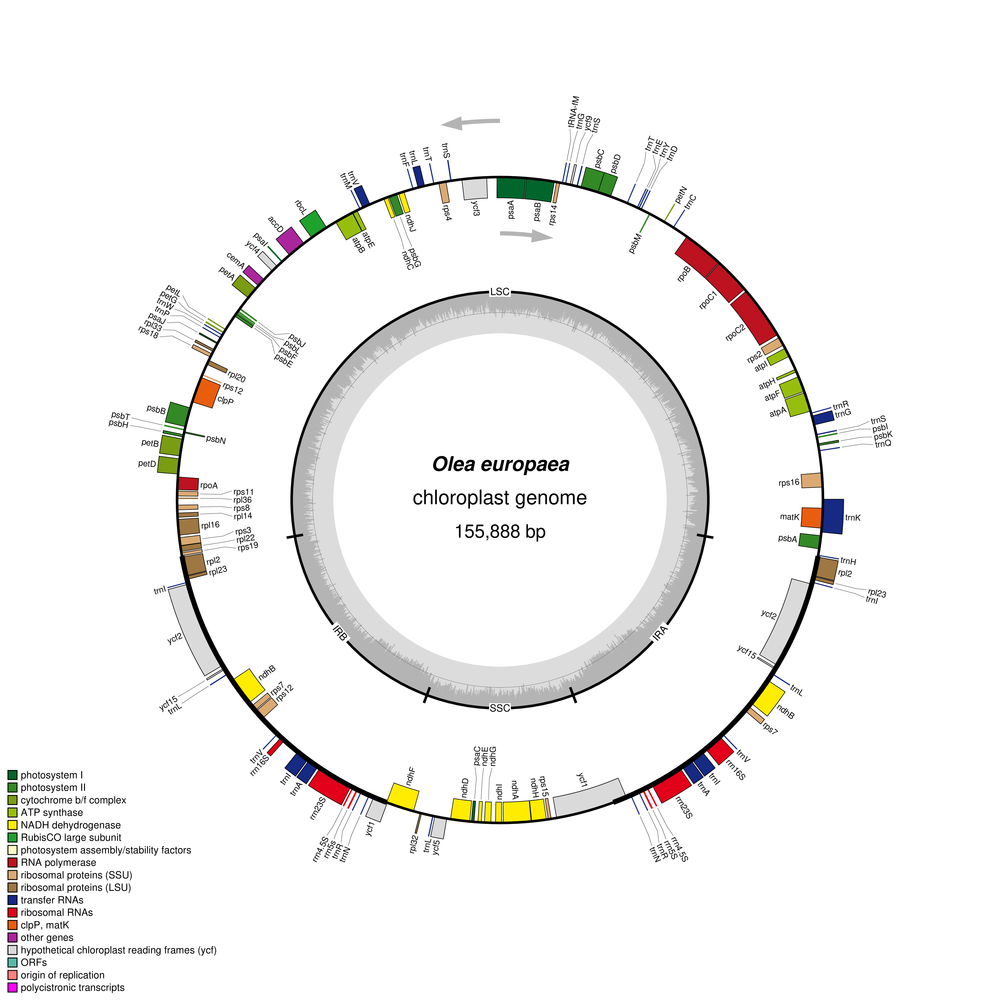

# Lab Plastid Genome Visualization — Olea europaea

## Student Information
* **Name:** Niña Karylle A. Catipay
* **Subject:** Cell and Molecular Biology
* **Section:** A

## Selected Plant
* **Scientific Name:** *Olea europaea*
* **NCBI Accession Number:** NC_013707.2
* **Plastid Genome Length:** 155,888 bp

## Source of Genome File
The annotated chloroplast GenBank file was obtained from the NCBI database under accession NC_013707.2. The file used for the visualization was:
`data/Olea_europaea_NC_013707.2.gb`

## Software Used
The plastid genome was visualized using **OrganellarGenomeDRAW (OGDRAW)**.

### OGDRAW Settings
The genome map was generated using the following parameters:
- Standard map mode
- Circular genome map
- Plastid sequence source
- Automatic inverted repeat detection
- GC content graph enabled
- Direction of transcription enabled
- Full legend enabled
- Intron-containing genes labeled with an asterisk (*)
- PNG output format
- Fine resolution

## Plastid Genome Map

## Main Structural Features Observed
The *Olea europaea* chloroplast genome exhibits a typical circular plastid genome organization consisting of a Large Single-Copy (LSC) region, a Small Single-Copy (SSC) region, and two Inverted Repeat regions (IRa and IRb). The map shows protein-coding genes, tRNA genes, and rRNA genes distributed around the genome. Genes are oriented in different directions, as indicated by the arrows showing the direction of transcription. The GC content graph shows variation in GC content across different regions of the plastid genome.

## Answers
The answers to the questions for this laboratory activity are provided in:  
[`answers/Lab_plastid_genome_answers.md`](answers/Lab_plastid_genome_answers.md)

## Files
- `data/Olea_europaea_NC_013707.2.gb` — annotated GenBank file used for visualization
- `figures/Olea_europaea_plastid_map.png` — OGDRAW plastid genome map
- `answers/Lab_plastid_genome_answers.md` — answers to Questions 1–10
